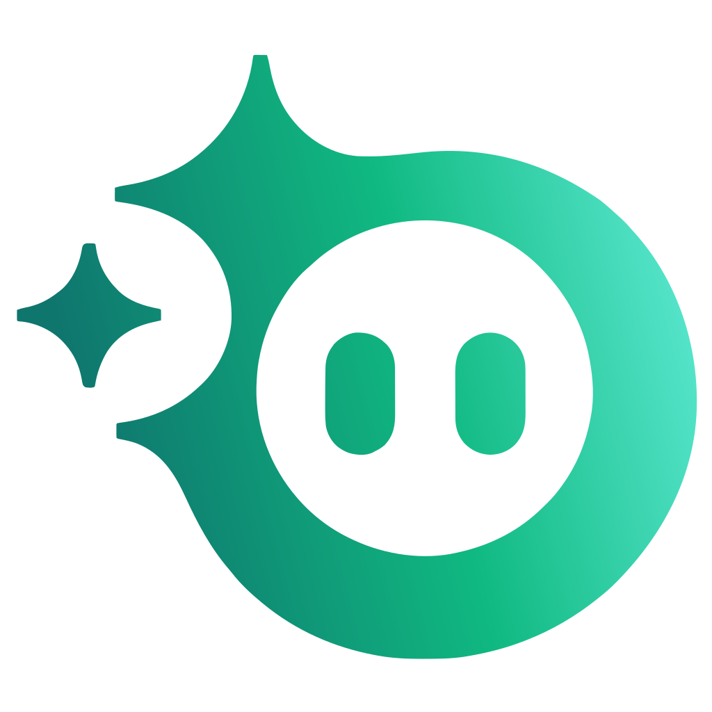

<p align="center">
  
</p>

<h1 align="center">Ottoman</h1>

<p align="center">
  <strong>Your voice companion for the browser.</strong><br />
  Talk to Ottoman and it browses, fills forms, shops, posts and grabs screenshots in your own Chrome.
</p>

<p align="center">
  
  
  
  
</p>

---

## ✨ What it does

- **Talk or type.** A Gemini Live voice session; press the mic, hit **Ctrl+Shift+Space** from anywhere, or open the chat and type.
- **Works in your own Chrome.** Ottoman drives the Chrome you already use, with your logins, through the Chrome DevTools Protocol. Its tabs open in an **Ottoman** tab group.
- **Sees the page like you do.** It reads the accessibility tree, clicks with a human-like pointer, fills forms, handles dropdowns, iframes and shadow DOM, and falls back to screenshots for canvas and images.
- **Asks before anything irreversible.** Paying, ordering, posting, commenting, sending, deleting and subscribing all wait for your OK: click **Yes** or just say "yes".
- **A living interface.** An animated Ottoman on a glowing blob that listens, works and talks, with captions that follow its voice word by word, a live voice wave, and a **Stop** button that silences it instantly.

## 🚀 Quick start

```sh
pnpm install
cp .env.example .env      # add your GEMINI_API_KEY
pnpm tauri dev
```

Closing the window hides Ottoman to the tray; quit from the tray menu.

| Setting | Where |
| --- | --- |
| `GEMINI_API_KEY` | `.env` (required) |
| `GEMINI_MODEL` | `.env` (optional; the model can also be picked in Settings) |
| `CHROME_PATH` | `.env` (optional, if Chrome is not in the default location) |
| Voice, your name, on-page cursor | ⚙ Settings in the app |

## 🧩 Connect Chrome

### The Ottoman extension (recommended)

1. Open `chrome://extensions` in the Chrome profile you want Ottoman to use.
2. Turn on **Developer mode** (top right).
3. Click **Load unpacked** and pick the [`extension`](extension) folder of this project.

That's it: no debugging setting and no Allow prompt. While Ottoman controls a tab, Chrome shows an "Ottoman started debugging this browser" bar; that is normal. If Chrome is closed, Ottoman starts it for you. To use another profile, load the extension there too.

> After pulling changes to the extension, click its reload ↻ button in `chrome://extensions`.

### Without the extension

Ottoman falls back to Chrome's own remote debugging: turn it on at `chrome://inspect/#remote-debugging` and click **Allow** when Chrome asks. Chrome accepts only one debugging client at a time.

## 🧪 Demo test site

```sh
pnpm demo                 # http://localhost:5555
```

Pages for forms, tricky widgets (controlled inputs, custom dropdowns, shadow DOM, iframes), a multi-step wizard, login, a shop with cart and checkout, a post composer, dynamic content, data extraction and hard cases (canvas, dialogs, CAPTCHA). Every submit is recorded: `GET /api/log` shows what the agent actually sent, and `DELETE /api/log` clears it.

Try: *"Go to localhost:5555/shop.html, find the cheapest wireless mouse under 30 dollars and buy it."*

## 🛠 Development

```sh
pnpm test                 # unit tests (Vitest)
pnpm build                # typecheck + production build
pnpm e2e                  # end-to-end: the real app and Gemini against the demo site
```

## 🗂 Project layout

| Path | What lives there |
| --- | --- |
| `src-tauri/src/lib.rs` | `.env`, Chrome launch, tray, global hotkey, files in Pictures/Ottoman |
| `src-tauri/src/relay.rs` | Local relay between the app and the Chrome extension |
| `extension/` | Chrome extension that lets Ottoman drive the browser |
| `src/live.ts` | Gemini Live session, audio, approval, Stop |
| `src/tools.ts` | Browser tools the model calls |
| `src/cdp.ts` | CDP client and tab tracking |
| `src/snapshot.ts` | Accessibility tree to `[ref]` lines for the model |
| `src/prompt.ts` | System instruction (safety rules first) |
| `src/App.tsx`, `src/components/` | The voice stage, chat sheet, animated mark, blob and voice wave |
